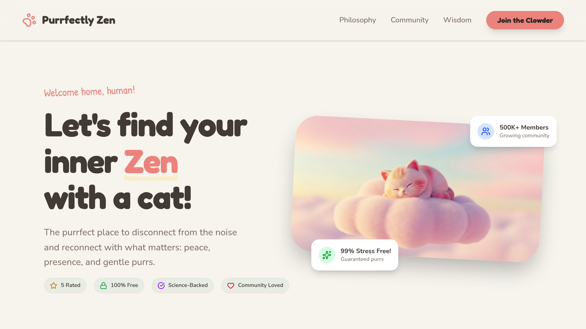

<div align="center" style="padding-top:24px;">


<h1 style="font-family: 'Fredoka', 'Nunito', sans-serif; font-size: 52px; font-weight: 800; letter-spacing: -0.04em; margin: 16px 0 4px 0; color: #2B2B2B;">
  Loresis
</h1>

<p style="font-family: 'Nunito', sans-serif; font-size: 18px; color: #E8A598; font-weight: 700; letter-spacing: 0.12em; text-transform: uppercase; margin: 0;">
  AI 角色扮演与故事创作工作台
</p>

<p style="margin: 14px 0 0 0;">
  <a href="https://zhuoming2026.github.io/Loresis/"></a>
  
  
</p>
<p style="margin: 6px 0 0 0;">
  
  
  
</p>

<p style="font-family: 'Nunito', sans-serif; font-size: 15px; color: #6B6B6B; max-width: 560px; margin: 18px auto 0 auto; line-height: 1.7;">
  给每一个爱做梦的人。<br/>
  在这里，和你喜欢的角色一起冒险、写故事、造世界 —— 像翻开一本暖暖的绘本，轻松上手，慢慢沉浸。✨
</p>

</div>

---

<!-- ==================== HERO 大图 ==================== -->
<div align="center" style="margin: 32px 0 8px 0;">

<p style="font-size:13px; letter-spacing:0.14em; color:#E8A598; font-weight:700; text-transform:uppercase; margin-bottom:12px;">✦ First Look ✦</p>

<a href="https://zhuoming2026.github.io/Loresis/" title="点击进入新手手册">

</a>

<p style="font-size: 12.5px; color: #9A9A9A; margin-top: 10px;">
  ↑ 点击大图，直接进入线上新手手册 · 暖米白 #F9F6F1 的柔软世界
</p>

</div>

<!-- ==================== 核心引导区：新手手册 ==================== -->
<div style="background: linear-gradient(135deg, #FFF8F4 0%, #FDF0EB 55%, #FDE8E0 100%); border: 1.5px solid #F0D8D0; border-radius: 32px; padding: 36px 28px 28px 28px; margin: 36px 0 28px 0; box-shadow: 0 20px 48px rgba(232,165,152,0.18), 0 4px 12px rgba(0,0,0,0.04); text-align: center;">

  <div style="display: inline-block; background: #FFFFFF; border: 1px solid #F0D8D0; color: #E8A598; font-size: 12px; font-weight: 700; letter-spacing: 0.12em; text-transform: uppercase; padding: 6px 14px; border-radius: 999px; margin-bottom: 14px;">
    🌷 Recommended First Step · 新人必看
  </div>

  <h2 style="font-family: 'Fredoka', 'Nunito', sans-serif; font-size: 30px; font-weight: 800; color: #2B2B2B; margin: 0 0 10px 0; line-height: 1.25;">
    📖 新手手册 → 点击开启冒险
  </h2>

  <p style="font-size: 15.5px; color: #6B6B6B; margin: 0 auto; max-width: 560px; line-height: 1.7;">
    6 章图文引导，从 <b style="color:#E8A598;">配置模型</b> 到 <b style="color:#E8A598;">创世写书</b>，跟着可爱的插画与截图，5 分钟就能跑起你的第一场角色扮演。
  </p>

  <div style="margin: 22px 0 18px 0;">
    <a href="https://zhuoming2026.github.io/Loresis/"
       style="display: inline-block; background: #E8A598; color: #FFFFFF; font-size: 16px; font-weight: 800; letter-spacing: 0.02em; text-decoration: none; padding: 15px 38px; border-radius: 999px; box-shadow: 0 12px 28px rgba(232,165,152,0.38), 0 4px 10px rgba(232,165,152,0.24); border: 1px solid #E8A598;">
      🚀 立即打开手册 — zhuoming2026.github.io/Loresis/
    </a>
    <div style="font-size: 12.5px; color: #B8A9A3; margin-top: 10px;">
      线上阅读 · 无需下载 · 手机 / 平板 / 电脑都好看 · 约 8 分钟读完
    </div>
  </div>

  <!-- 6 章目录预览 -->
  <div style="background: #FFFFFF; border: 1px solid #F0E6E0; border-radius: 20px; padding: 16px 14px; max-width: 720px; margin: 0 auto; text-align: left;">
    <div style="font-size: 11px; font-weight: 700; letter-spacing: 0.12em; text-transform: uppercase; color: #E8A598; margin-bottom: 10px; text-align: center;">— 手册目录 · 6 章节一口气看完 —</div>
    <table style="width: 100%; border-collapse: collapse; font-size: 13px; line-height: 1.6;">
      <tr>
        <td style="padding: 7px 10px; width: 33.33%; vertical-align: top;">
          <span style="display:inline-block; background:#F9F6F1; border:1px solid #EDE8E3; color:#E8A598; font-weight:800; font-size:11px; padding:1px 7px; border-radius:999px; margin-right:4px;">CH1</span>
          <span style="color:#2B2B2B; font-weight:700;">配置模型和主角</span><br/>
          <span style="color:#9A9A9A; font-size:12px;">选模型 · 设主角 · 第一次对话</span>
        </td>
        <td style="padding: 7px 10px; width: 33.33%; vertical-align: top;">
          <span style="display:inline-block; background:#F0FAF6; border:1px solid #D6F0E6; color:#6BC4A0; font-weight:800; font-size:11px; padding:1px 7px; border-radius:999px; margin-right:4px;">CH2</span>
          <span style="color:#2B2B2B; font-weight:700;">导入角色卡</span><br/>
          <span style="color:#9A9A9A; font-size:12px;">一键导入 · 立刻开演</span>
        </td>
        <td style="padding: 7px 10px; width: 33.33%; vertical-align: top;">
          <span style="display:inline-block; background:#FFF6F0; border:1px solid #F0D8D0; color:#E8A598; font-weight:800; font-size:11px; padding:1px 7px; border-radius:999px; margin-right:4px;">CH3</span>
          <span style="color:#2B2B2B; font-weight:700;">开始会话</span><br/>
          <span style="color:#9A9A9A; font-size:12px;">聊天 · 推进剧情 · 存档</span>
        </td>
      </tr>
      <tr>
        <td style="padding: 7px 10px; vertical-align: top;">
          <span style="display:inline-block; background:#F9F6F1; border:1px solid #EDE8E3; color:#E8A598; font-weight:800; font-size:11px; padding:1px 7px; border-radius:999px; margin-right:4px;">CH4</span>
          <span style="color:#2B2B2B; font-weight:700;">定制写手</span><br/>
          <span style="color:#9A9A9A; font-size:12px;">调教你的专属 AI 作者</span>
        </td>
        <td style="padding: 7px 10px; vertical-align: top;">
          <span style="display:inline-block; background:#F0FAF6; border:1px solid #D6F0E6; color:#6BC4A0; font-weight:800; font-size:11px; padding:1px 7px; border-radius:999px; margin-right:4px;">CH5</span>
          <span style="color:#2B2B2B; font-weight:700;">创建世界</span><br/>
          <span style="color:#9A9A9A; font-size:12px;">世界书 · 地点 · 设定集</span>
        </td>
        <td style="padding: 7px 10px; vertical-align: top;">
          <span style="display:inline-block; background:#FFF6F0; border:1px solid #F0D8D0; color:#E8A598; font-weight:800; font-size:11px; padding:1px 7px; border-radius:999px; margin-right:4px;">CH6</span>
          <span style="color:#2B2B2B; font-weight:700;">主题设置</span><br/>
          <span style="color:#9A9A9A; font-size:12px;">浅色/深色 · 字体 · 圆角美学</span>
        </td>
      </tr>
    </table>
  </div>

  <p style="font-size: 12px; color: #C4B5B0; margin: 12px 0 0 0;">
    💡 小提示：手册本地入口在 <code style="background:#FFFFFF; border:1px solid #F0D8D0; padding:2px 6px; border-radius:6px; color:#E8A598;">/Users/zhuoming/lzm/GitHubPage/Loresis/index.html</code>，也可直接点上方按钮线上阅读
  </p>

</div>

<!-- ==================== 三大特性 ==================== -->
<div align="center" style="margin: 8px 0 6px 0;">
  <p style="font-size:13px; letter-spacing:0.14em; color:#E8A598; font-weight:700; text-transform:uppercase; margin: 0;">✦ Core Experience ✦</p>
  <h2 style="font-family:'Fredoka','Nunito',sans-serif; font-size:26px; font-weight:800; color:#2B2B2B; margin: 8px 0 6px 0;">做故事的人，而不是调参数的人</h2>
  <p style="font-size:14px; color:#9A9A9A; margin:0;">三张原型卡，带你看懂 Loresis 在做什么</p>
</div>

<table style="width: 100%; border-collapse: separate; border-spacing: 14px 0; margin: 18px 0 28px 0;">
<tr>
<td style="width: 33.33%; vertical-align: top; text-align: center;">

<div style="background:#F9F6F1; border:1px solid #EDE8E3; border-radius:28px; padding:18px 16px 18px 16px; box-shadow: 0 8px 24px rgba(0,0,0,0.04);">


<div style="display:inline-block; background:#2B2B2B; color:#FFFFFF; font-size:11px; font-weight:700; letter-spacing:0.08em; padding:4px 10px; border-radius:999px; margin-bottom:8px;">ADVENTURE · 冒险</div>

<h3 style="font-size:16px; font-weight:800; color:#2B2B2B; margin:6px 0 6px 0;">和角色一起冒险</h3>
<p style="font-size:13px; color:#7A7A7A; line-height:1.65; margin:0;">
  导入角色卡就开演。<br/>对话推动剧情，存档回溯分支，<br/>每一句都是新展开。
</p>

</div>

</td>
<td style="width: 33.33%; vertical-align: top; text-align: center;">

<div style="background:#F0FAF6; border:1px solid #D6EDE3; border-radius:28px; padding:18px 16px 18px 16px; box-shadow: 0 8px 24px rgba(0,0,0,0.04);">


<div style="display:inline-block; background:#6BC4A0; color:#FFFFFF; font-size:11px; font-weight:700; letter-spacing:0.08em; padding:4px 10px; border-radius:999px; margin-bottom:8px;">WRITER · 写手</div>

<h3 style="font-size:16px; font-weight:800; color:#2B2B2B; margin:6px 0 6px 0;">定制你的 AI 写手</h3>
<p style="font-size:13px; color:#7A7A7A; line-height:1.65; margin:0;">
  语气、节奏、留白都可调。<br/>让 AI 像你一样写作，<br/>而不是替你写作。
</p>

</div>

</td>
<td style="width: 33.33%; vertical-align: top; text-align: center;">

<div style="background:#FFF8F4; border:1px solid #F0D8D0; border-radius:28px; padding:18px 16px 18px 16px; box-shadow: 0 8px 24px rgba(0,0,0,0.04);">


<div style="display:inline-block; background:#E8A598; color:#FFFFFF; font-size:11px; font-weight:700; letter-spacing:0.08em; padding:4px 10px; border-radius:999px; margin-bottom:8px;">WORLDBUILD · 创世</div>

<h3 style="font-size:16px; font-weight:800; color:#2B2B2B; margin:6px 0 6px 0;">创造一个世界</h3>
<p style="font-size:13px; color:#7A7A7A; line-height:1.65; margin:0;">
  世界书、地点、势力、年表。<br/>设定一次，处处生效，<br/>故事从此有根。
</p>

</div>

</td>
</tr>
</table>

<div align="center" style="margin: -8px 0 30px 0;">
  <span style="font-size:12px; color:#B8A9A3;">三原型图来自手册真实界面 · 圆角 2rem · 毛玻璃导航 · 猫猫插画点缀 🐾</span>
</div>

<!-- ==================== 截图预览 ==================== -->
<div style="background:#F9F6F1; border:1px solid #EDE8E3; border-radius:28px; padding:26px 18px 20px 18px; margin: 0 0 32px 0;">

<div align="center">
  <p style="font-size:13px; letter-spacing:0.14em; color:#6BC4A0; font-weight:700; text-transform:uppercase; margin:0;">✦ Gallery ✦</p>
  <h2 style="font-family:'Fredoka','Nunito',sans-serif; font-size:24px; font-weight:800; color:#2B2B2B; margin: 8px 0 6px 0;">截图预览 · 手册里长这样</h2>
  <p style="font-size:13.5px; color:#9A9A9A; margin:0 0 18px 0;">四张真实章节截图，感受一下手册的排版与插画氛围</p>
</div>

<div align="center" style="display:flex; flex-wrap:wrap; justify-content:center; gap:14px;">

  <div style="background:#FFFFFF; border:1px solid #EDE8E3; border-radius:20px; padding:10px; box-shadow:0 10px 24px rgba(0,0,0,0.06);">
    
    <div style="font-size:11px; font-weight:700; color:#2B2B2B; margin-top:8px;">Ch1 · 配置模型和主角</div>
    <div style="font-size:11px; color:#9A9A9A;">第一步就很可爱</div>
  </div>

  <div style="background:#FFFFFF; border:1px solid #EDE8E3; border-radius:20px; padding:10px; box-shadow:0 10px 24px rgba(0,0,0,0.06);">
    
    <div style="font-size:11px; font-weight:700; color:#2B2B2B; margin-top:8px;">Ch2 · 导入角色卡</div>
    <div style="font-size:11px; color:#9A9A9A;">拖进来就能演</div>
  </div>

  <div style="background:#FFFFFF; border:1px solid #EDE8E3; border-radius:20px; padding:10px; box-shadow:0 10px 24px rgba(0,0,0,0.06);">
    
    <div style="font-size:11px; font-weight:700; color:#2B2B2B; margin-top:8px;">Ch3 · 开始会话</div>
    <div style="font-size:11px; color:#9A9A9A;">让故事动起来</div>
  </div>

  <div style="background:#FFFFFF; border:1px solid #EDE8E3; border-radius:20px; padding:10px; box-shadow:0 10px 24px rgba(0,0,0,0.06);">
    
    <div style="font-size:11px; font-weight:700; color:#2B2B2B; margin-top:8px;">Ch5 · 创建世界</div>
    <div style="font-size:11px; color:#9A9A9A;">给想象一个家</div>
  </div>

</div>

<div align="center" style="margin-top:16px;">
  <a href="https://zhuoming2026.github.io/Loresis/" style="font-size:13px; color:#E8A598; font-weight:700; text-decoration:none; border:1px solid #F0D8D0; background:#FFFFFF; padding:7px 16px; border-radius:999px; display:inline-block;">
    查看全部 16 张截图 → 去手册里翻
  </a>
  <span style="font-size:12px; color:#B8A9A3; margin-left:6px;">还有 Ch4 / Ch6 / Ch7 等等</span>
</div>

</div>

<!-- 插画彩蛋条 -->
<div style="background:#FFFFFF; border:1px dashed #E8A598; border-radius:20px; padding:14px 18px; display:flex; align-items:center; gap:14px; margin: 0 0 32px 0;">


<div style="flex:1;">
  <div style="font-size:13px; font-weight:800; color:#2B2B2B;">手册里还有很多猫猫 🐱</div>
  <div style="font-size:12.5px; color:#9A9A9A; line-height:1.5;">打坐的、贪吃的、云朵上睡觉的…… 每一章都有小插画陪你学，不会枯燥。</div>
</div>

<a href="https://zhuoming2026.github.io/Loresis/guide/" style="flex-shrink:0; background:#F9F6F1; border:1px solid #EDE8E3; color:#E8A598; font-size:12px; font-weight:700; text-decoration:none; padding:8px 14px; border-radius:999px; white-space:nowrap;">
  去看看 →
</a>

</div>

---

## 🚀 快速开始

> **一句话：先看手册，再动手。**

| 步骤 | 做什么 | 去哪里 |
| :--- | :--- | :--- |
| **① 读手册** | 跟着 6 章图文走一遍，有心理预期 | [📖 线上新手手册](https://zhuoming2026.github.io/Loresis/) |
| **② 配环境** | 按 Ch1 配置模型与主角 | 手册 Ch1 → [配置模型和主角](https://zhuoming2026.github.io/Loresis/guide/) |
| **③ 开演** | 导入一张角色卡，开始第一场会话 | 手册 Ch2 & Ch3 |
| **④ 造世界** | 觉得好玩？再去 Ch4 / Ch5 定制写手与世界 | 手册 Ch4 - Ch6 |

本地同学也可以直接打开：

```
open /Users/zhuoming/lzm/GitHubPage/Loresis/index.html
# 或把整个 Loresis 文件夹用 VS Code Live Server / python -m http.server 跑起来
```

---

## 💬 常见问题 · 轻问快答

<details>
<summary><b>Q: 我是纯小白，能用吗？</b></summary>

能！手册就是为小白写的。Ch1 会手把手教你从零开始，不用懂代码，跟着截图点就行。猫猫都会，你也会。🐾

</details>

<details>
<summary><b>Q: 手册和 README 有什么区别？</b></summary>

README 是地图，手册是向导。README 告诉你「这里有什么」，手册带你「一步一步做出来」。想快速了解看 README，想真正上手一定要点进手册。→ [去手册](https://zhuoming2026.github.io/Loresis/)

</details>

<details>
<summary><b>Q: 需要科学上网吗？</b></summary>

手册本身是 GitHub Pages，国内可直连。模型配置部分取决于你选的模型服务商，手册里有说明。

</details>

<details>
<summary><b>Q: 图片加载不出来怎么办？</b></summary>

本 README 所有图片用的都是 `https://zhuoming2026.github.io/Loresis/...` 绝对路径，GitHub 预览可直接加载。如果本地预览不到，请检查是否离线，或直接线上阅读手册。

</details>

---

## 🌟 喜欢就给个 Star 吧

<div align="center" style="background: linear-gradient(135deg, #FFF8F4 0%, #F9F6F1 100%); border: 1px solid #EDE8E3; border-radius: 24px; padding: 22px 18px; margin: 16px 0;">

<p style="font-size: 22px; margin: 0 0 6px 0;">🐾</p>
<p style="font-size: 15px; font-weight: 800; color: #2B2B2B; margin: 0 0 6px 0;">如果 Loresis 让你想起了某个想写的故事</p>
<p style="font-size: 13px; color: #9A9A9A; margin: 0 0 14px 0; line-height: 1.6;">
  就点一下右上角的 ⭐ Star，让更多爱写故事的人找到这里。<br/>
  你的 Star 是我们继续画更多猫猫插画的动力！
</p>

<a href="https://github.com/zhuoming2026/Loresis">
  
</a>

<p style="font-size: 12px; color: #C4B5B0; margin: 10px 0 0 0;">
  也欢迎提 Issue / 讨论，手册每章底部都有反馈入口
</p>

</div>

---

## 🗺️ 目录导航

- [📖 新手手册 · 线上版](https://zhuoming2026.github.io/Loresis/) — **最推荐的起点**
- [Ch1 配置模型和主角](https://zhuoming2026.github.io/Loresis/guide/) · [Ch2 导入角色卡](https://zhuoming2026.github.io/Loresis/guide/) · [Ch3 开始会话](https://zhuoming2026.github.io/Loresis/guide/)
- [Ch4 定制写手](https://zhuoming2026.github.io/Loresis/guide/) · [Ch5 创建世界](https://zhuoming2026.github.io/Loresis/guide/) · [Ch6 主题设置](https://zhuoming2026.github.io/Loresis/guide/)
- [探索 · Explore](https://zhuoming2026.github.io/Loresis/explore/) · [关于 · About](https://zhuoming2026.github.io/Loresis/about/) · [FAQ](https://zhuoming2026.github.io/Loresis/faq/)

---

## 🖼️ README 怎么放图片？

> 给想自己改 README 的小伙伴，3 种常用方法，GitHub 都能渲染 👇

### 方法 1 · 相对路径（仓库内图片）

适合放在仓库里的图，提交后 GitHub 自动解析。

```markdown


```

### 方法 2 · 绝对 URL（推荐用于 GitHub Pages 预览）

本 README 全部用这种，保证在 GitHub 列表页也能直接加载，不受分支/路径影响。

```markdown


```

> 中文文件名记得 **URL 编码**，比如 `黑色原型.CmG_S5fn.png` → `%E9%BB%91%E8%89%B2%E5%8E%9F%E5%9E%8B.CmG_S5fn.png`

### 方法 3 · HTML 控制大小 / 圆角 / 阴影（最灵活）

想让图片圆角、控宽度、加阴影，就用 HTML。在 GitHub Markdown 里是允许的。

```html
<!-- 居中 + 圆角阴影大图 -->
<p align="center">
  
</p>

<!-- 横向多图，控制每张宽度 -->
<p align="center">
  
  
  
</p>
```

**小技巧：**
- `width="200"` 控制大小，比 Markdown 的 `` 更可控
- `style="border-radius: 16px; box-shadow: ..."` 加圆角和阴影，和手册风格统一（`#F9F6F1` 米白 + `#E8A598` 珊瑚粉）
- 外层包 `<a href="https://zhuoming2026.github.io/Loresis/">` 就能让图片可点击跳转
- 只用 `div / table / p / img / a` + 行内 `style`，不要引入外部 CSS，GitHub 才会保留样式

---

<div align="center" style="margin-top: 28px; padding: 18px; background: #F9F6F1; border: 1px solid #EDE8E3; border-radius: 20px;">


<p style="font-size: 13px; color: #9A9A9A; margin: 10px 0 0 0; line-height: 1.7;">
  Loresis · 写给爱做梦的人<br/>
  <span style="color:#E8A598; font-weight:700;">暖米白 #F9F6F1</span> + <span style="color:#6BC4A0; font-weight:700;">薄荷绿</span> + <span style="color:#E8A598; font-weight:700;">珊瑚粉 #E8A598</span> · 圆角 2rem · Fredoka / Nunito<br/>
  手册持续更新中 — 有想法就来 <a href="https://zhuoming2026.github.io/Loresis/contact/" style="color:#E8A598; font-weight:700; text-decoration:none;">联系我们</a> 吧
</p>

</div>
